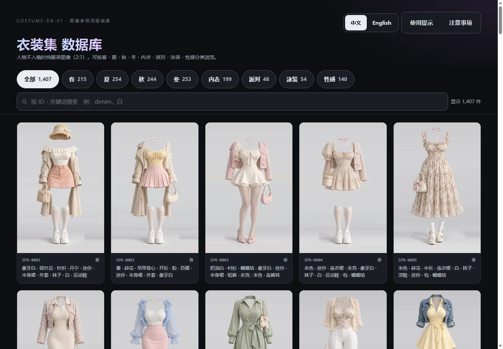
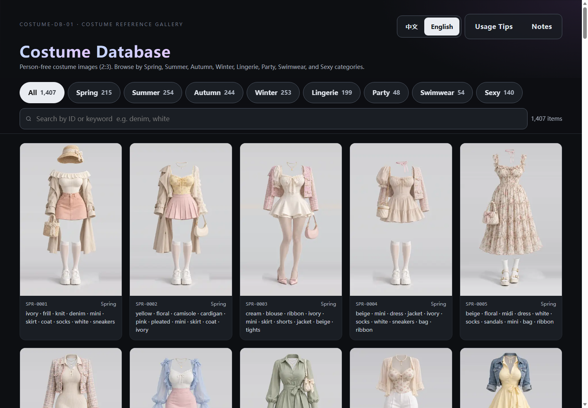
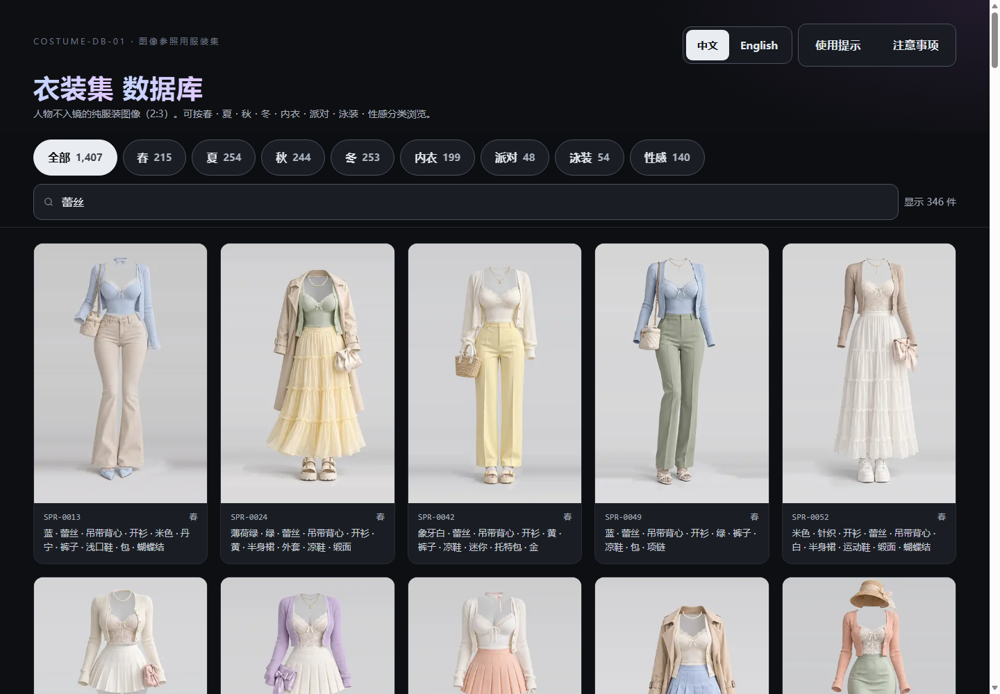

# 衣装集 COSTUME-DB-01 · AI 服装参考图集

一个深色主题的服装参考图集网站，收录 **1407 张** 人物不入镜的 AI 生成服装图像（2:3 比例），支持中英文双语浏览与检索。

> 🔗 **在线预览**：https://paipiange.github.io/nvzhuang/  
> 💡 **原作者推文 / 灵感来源**：X [@giaaibusi](https://x.com/giaaibusi)  
> 🐧 **社区友链**：[LINUX DO (https://linux.do/)](https://linux.do/)

## ⏱️ 10 秒了解本项目

- 🆓 **免费使用（无需部署 / 无需 Key）**：1407 套 AI 服装参考图库浏览、分类筛选、中英双语双向检索、大图全屏查看、基础搭配台与同款跳转，由纯前端静态驱动，在线打开即可使用。
- ⚙️ **自选扩展（需自建后端 / 需自备 Key）**：真实 AI 试衣换装功能依赖 `backend/` 的 GoFrame 服务。需自行配置大模型（如 GPT Image 2、豆包 Seedream 或 Gemini）的 API Key 与 Base URL，调用将消耗对应的第三方模型配额。
- 📜 **完全可商用 · 免费开源**：基于 [MIT License](LICENSE) 全量开源，代码与图集资源完全开放，支持自由商用创作、设计参考及二次开发。详见 [合规审计报告](docs/LINUXDO_RELEASE_AUDIT.md)。

## 📸 预览

| 中文模式 | 英文模式 | 关键词搜索 |
|---|---|---|
|  |  |  |

## 👗 AI 换装效果演示

系统支持上传真实人像与选中的服装，通过 AI 生图大模型进行衣物迁移换装，实现精准保留面容、贴合人体形态的虚拟试穿效果：

| ① 选中的服装（图 1） | ② 上传的模特照片（图 2） | ③ AI 换装合成效果（图 3） |
|:---:|:---:|:---:|
|  |  |  |
| **参考服装图**<br><sub>（图集中的精选女装）</sub> | **模特原图**<br><sub>（用户上传的人像日常照）</sub> | **AI 换装效果（图 1 + 图 2 ➔ 图 3）**<br><sub>（保留模特五官发型，自然融合服饰材质与剪裁）</sub> |

## ✨ 功能特性

- **8 大分类**：春（215）/ 夏（254）/ 秋（244）/ 冬（253）/ 内衣（199）/ 派对（48）/ 泳装（54）/ 性感（140）
- **中英文双语**：默认中文，右上角一键切换 English
- **双向检索**：中文（白、蕾丝、连衣裙…）和英文（white、lace、dress…）关键词都能搜索
- **关键词本地化**：中文模式自动将服装属性翻译为中文展示
- **交互体验**：分类筛选、实时搜索、无限滚动加载、放大查看、键盘 ←/→ 切换、Esc 关闭、原尺寸 PNG 下载
- **AI 试穿搭配台**：上传人像 + 选服装，在线预览、拖拽缩放、抠图合成，或一键 AI 换装（需自备后端）

## 🤖 AI 换装（可选功能）

「AI 换装」需要一个后端服务，把服装真实地「穿」到人像上。后端位于 `backend/`（GoFrame v2），支持**多模型可插拔**：

| 模型别名 | 模型 | 协议 | 说明 |
|---|---|---|---|
| `gemini` | **Nano Banana 2**（`gemini-3.1-flash-image`） | Google generateContent | **默认模型**，对真人换装场景无 moderation 阻断 |
| `doubao` | 豆包 Seedream（火山方舟） | 火山方舟 | 国内可用，无需代理网络 |
| `gpt-image` | **GPT Image 2**（`gpt-image-2`） | OpenAI Images | 兼容 OpenAI 协议，支持第三方中转与代理 |
| `qwen` / `zhipu` / `siliconflow` … | 通义万相 / 智谱 CogView / 硅基流动 | OpenAI Images 兼容 | 按需在配置中开启 |

> 三个关键点都可配置：**API Key、Base URL、模型名**。加一个国内模型只需在配置里新增一段，无需改代码。

### 配置模型

编辑 `backend/manifest/config/config.yaml`（模板见 `config.example.yaml`）：

```yaml
llm:
  models:
    gpt-image:                     # 前端请求用的别名
      provider: openai             # 协议：openai / doubao / gemini
      apiKey: ""                   # 直接填 Key，或留空用环境变量
      envKey: "OPENAI_API_KEY"     # 环境变量名（优先级高于 apiKey）
      baseURL: "https://api.openai.com/v1"   # Base URL 可改（支持中转/代理）
      model: "gpt-image-2"         # 真实模型名

    doubao:                        # 豆包（国内可用）
      provider: doubao
      envKey: "ARK_API_KEY"
      baseURL: "https://ark.cn-beijing.volces.com/api/v3"
      model: "doubao-seedream-3-0-t2i-250415"

    gemini:
      provider: gemini
      envKey: "GEMINI_API_KEY"
      baseURL: "https://generativelanguage.googleapis.com/v1beta"
      model: "gemini-3.1-flash-image"
```

**接入任意 OpenAI 兼容的国内生图模型**（通义万相、智谱、硅基流动等），加一段即可：

```yaml
    qwen:                          # 通义万相示例
      provider: openai
      envKey: "DASHSCOPE_API_KEY"
      baseURL: "https://dashscope.aliyuncs.com/compatible-mode/v1"
      model: "wanx2.1-t2i-turbo"
```

### 🚀 后端部署（优先推荐 Docker）

后端推荐使用 **Docker / Docker Compose** 部署，无需在宿主机安装 Go 编译环境，开箱即用。

#### 方式一：Docker Compose（推荐，最省心）

```bash
# 1. 复制环境变量模板并填入你的 Key（如国内免翻墙的豆包 ARK_API_KEY，或 OpenAI Key）
cp backend/.env.example backend/.env

# 2. 一键启动后端
docker compose up -d

# 服务启动后监听在 http://localhost:8000
```

#### 方式二：Docker Run 单命令运行

```bash
cd backend

# 构建镜像
docker build -f manifest/docker/Dockerfile -t costume-tryon .

# 运行容器（按需注入模型 Key，例如豆包或 OpenAI）
docker run -d --name costume-tryon \
  -p 8000:8000 \
  -e ARK_API_KEY="你的豆包ArkKey" \
  -e OPENAI_API_KEY="sk-你的OpenAIKey" \
  costume-tryon
```

#### 方式三：无 Docker 本地运行

- **Windows 用户**：直接双击 `backend/restart.bat` 一键自动编译并启动服务。
- **命令行运行**：
  ```bash
  cd backend
  export ARK_API_KEY="你的Key"   # Windows PowerShell 用 $env:ARK_API_KEY="你的Key"
  go run main.go                 # 服务监听 :8000
  ```

### 🔗 前端对接后端

前端静态页面通过以下顺序识别换装后端地址（优先级从高到低）：

1. **全局变量**：在 HTML 加载前配置 `window.AI_API_URL = "http://localhost:8000"`
2. **URL 参数**：`https://你的前端地址/?tryon=http://localhost:8000`
3. **本地回退**：本地以 `localhost` 或 `127.0.0.1` 访问前端时，默认自动连接 `http://127.0.0.1:8000`

> 完整的多模型接入、生产环境 Nginx 反代与安全加固说明见 [`backend/DEPLOY.md`](backend/DEPLOY.md)。

## 🚀 前端本地启动

本项目前端是纯静态站点，无需构建。任选一种方式运行：

```bash
# 方式一：Python 内置服务器（推荐端口 3000，与后端 8000 端口独立不冲突）
python3 -m http.server 3000

# 方式二：Node 简单服务器
npx serve -l 3000 .

# 方式三：直接用现代浏览器打开 index.html
```

启动后在浏览器打开 `http://localhost:3000`。若同时启动了后端，本地换装开箱即连。

## 📁 目录结构

```
nvzhuang/
├── index.html          # 页面结构 + 样式 + 交互逻辑（含双语字典、AI 试穿搭配台）
├── data.js             # 1407 条服装数据（id / 分类 / 关键词 / 图片路径）
├── docker-compose.yml  # 一键启动后端 Docker 容器编排
├── assets/
│   ├── thumbs/         # 缩略图（webp，网格卡片用）
│   └── img/            # 展示图（webp，弹窗放大用）
├── docs/               # 文档图片与试穿效果演示图
├── backend/            # AI 换装后端（GoFrame v2，可选）
│   ├── docker-compose.yml                 # 后端 Docker Compose 配置
│   ├── .env.example                       # 环境变量示例文件
│   ├── restart.bat / build.bat            # Windows 本地一键启动/重新编译脚本
│   ├── manifest/config/config.yaml        # 模型配置（Key / BaseURL / 模型名）
│   ├── internal/logic/tryon/              # 模型适配器（openai / doubao / gemini）
│   └── DEPLOY.md                          # 部署指南
└── .gitignore
```

> 注：原尺寸 PNG（约 1GB+）未纳入仓库，「下载原尺寸」按钮指向原站资源。

## 🔗 URL 参数

支持通过 URL 参数直接分享特定状态：

```
?lang=en          # 初始语言（zh 为中文，en 为英文，默认 zh）
?q=lace           # 初始搜索词
?lang=en&q=white  # 组合使用
```

## 💡 灵感来源与社区友链

- **原作者 / 灵感来源**：[X @giaaibusi](https://x.com/giaaibusi) —— 诚挚鸣谢原作者对高质量 AI 服装图集的整理与创意分享！
- **社区友链**：[LINUX DO (https://linux.do/)](https://linux.do/) —— 真诚、友善、团结、专业的开源与技术极客社区。
- **审计与规范文档**：
  - [项目现状与开源合规审计报告 (LINUXDO_RELEASE_AUDIT.md)](docs/LINUXDO_RELEASE_AUDIT.md)
  - [图库内容合规与社区发布审查报告 (CONTENT_REVIEW.md)](docs/CONTENT_REVIEW.md)
  - [Linux.do 推广发布前核验清单 (LINUXDO_PUBLISH_CHECKLIST.md)](docs/LINUXDO_PUBLISH_CHECKLIST.md)

## 📄 开源许可证与使用规范

本项目基于 **[MIT License](LICENSE)** 协议完全免费开源，允许无限制商业使用：

- **开源协议**：[MIT License](LICENSE)，代码与资产完全免费开源，允许商业使用、自由修改、集成与分发。
- **商用与创作自由**：可完全免费用于各类个人与商业作品创作（如电商广告、服装设计参考、游戏资产、AI 图像与虚拟换装应用）。
- **生成属性声明**：所有图像均为 AI 生成（t2i）概念服装设计，非现实品牌商品照片。

## 📝 数据说明

数据存于 `data.js`，每条记录包含：

| 字段 | 说明 |
|---|---|
| `id` | 编号（如 `SPR-0001`） |
| `カテゴリ` | 分类（日文分类名，如「春」） |
| `キーワード` | 关键词（英文，空格分隔） |
| `サムネ` | 缩略图路径 |
| `画像` | 展示图路径 |
| `原寸` | 原尺寸 PNG 路径 |

> 说明：`カテゴリ`、`キーワード`、`サムネ`、`画像`、`原寸` 是数据原始的日文字段名，为保持与原站数据兼容而保留。网站会在前端自动将它们本地化为中文或英文展示。

### Data Fields (English)

Each record in `data.js` contains the following fields:

| Field | Description |
|---|---|
| `id` | Identifier (e.g. `SPR-0001`) |
| `カテゴリ` | Category (Japanese category name, e.g. "春" for Spring) |
| `キーワード` | Keywords (English, space-separated) |
| `サムネ` | Thumbnail image path |
| `画像` | Display image path |
| `原寸` | Full-size PNG path |

> Note: `カテゴリ`, `キーワード`, `サムネ`, `画像`, and `原寸` are the original Japanese field names kept for compatibility with the source data. The site localizes them to Chinese or English on the frontend automatically.
